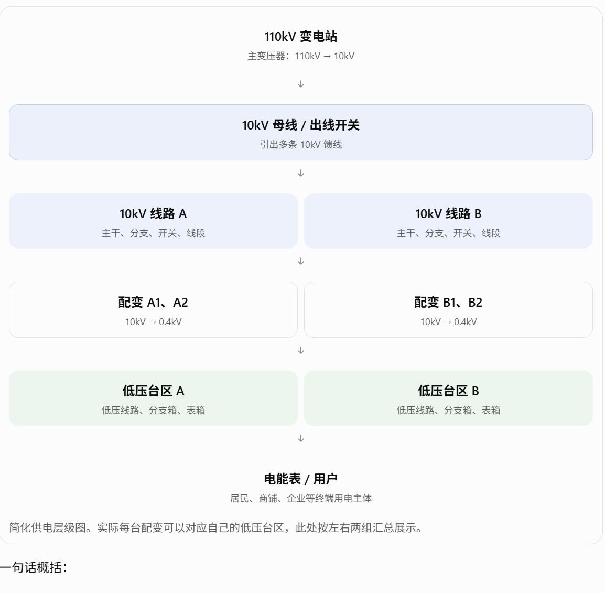

|概念|含义|典型关系|
|---|---|---|
|变电站|对电能进行变压、汇集、分配的场所|一个变电站引出多条馈线|
|线路（馈线）|从某个电源出线点延伸出去的一条供电线路|一条线路包含多个线段、开关及分支|
|线段|线路中的一个具体连续区段|多个线段构成线路及其分支|
|开关|控制线路接通、断开及故障隔离|连接或隔离相邻电气区段|
|配电变压器（配变）|将10kV等中压电压转换为0.4kV等低压电压|一条线路通常连接多台配变|
|台区|通常指一台配变的低压供电范围及其管理单元|一个典型公变台区对应一台配变|
|低压线路|从配变低压侧向各用户输送电能|一个台区包含多条低压分支|
|用户|用电主体，例如居民、企业|一个台区通常服务多个低压用户|
|电能表|用户用电的计量设备|用户与电表不一定是一对一关系|
