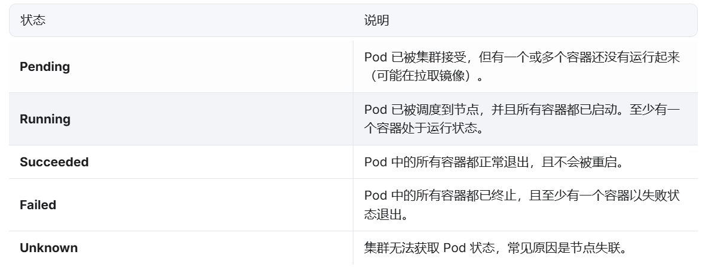
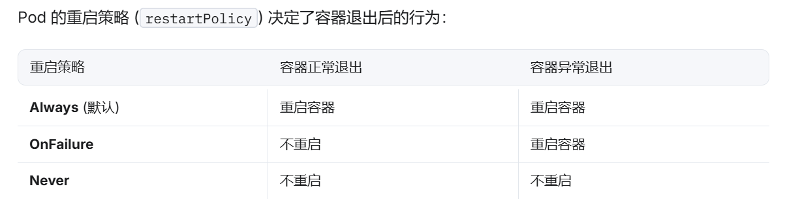
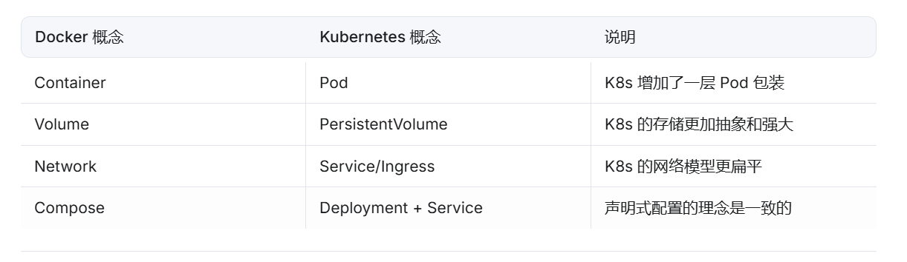

LINK:https://chatgpt.com/share/6a794651-f280-83ec-9c4d-f6fc16a361b6
# 常用命令
### 1. 集群上下文与命名空间

- `kubectl config current-context`：查看当前连接的集群上下文。
    
- `kubectl config use-context <context-name>`：切换集群上下文。
    
- `kubectl get ns`：查看所有命名空间（Namespace）。
    
- `kubectl config set-context --current --namespace=<ns>`：把当前上下文的默认命名空间切到指定 `<ns>`，避免每次加 `-n`。
    

### 2. 部署与变更（声明式为主）
- `kubectl apply -f <file.yaml|dir>`：创建或更新 YAML 文件/目录中的资源（最推荐的日常变更方式）。
- `kubectl diff -f <file.yaml>`：应用前对比本地清单与集群现有资源的差异。
- `kubectl delete -f <file.yaml>` 或 `kubectl delete pod <pod-name>`：删除清单中的资源或指定对象。
- `kubectl scale deployment/<name> --replicas=5`：快速调整 Deployment 或 ReplicaSet 的副本数。
- `kubectl set image deployment/<name> <container>=<new-image>`：更新镜像触发滚动升级。
### 3. 查看状态与资源关联

- `kubectl get pods` / `kubectl get deploy,rs,po,svc`：查看资源列表（可加 `-o wide` 看所在节点和 IP，加 `-w` 持续监听变化，加 `-A` 看所有命名空间）。
    
- `kubectl describe pod <pod-name>` / `kubectl describe deploy <name>`：查看资源详情与底部 **Events**，是排查调度失败、镜像拉取失败或标签不匹配的首选命令。
    
- `kubectl get <kind> <name> -o yaml`：导出资源的完整 YAML 定义（排查实际生效配置很有用）。
    

### 4. 日志与容器内排查

- `kubectl logs <pod-name>`：查看 Pod 容器的标准输出日志（加 `-f` 实时跟踪，加 `-c <container>` 指定多容器 Pod 中的某个容器，加 `--previous` 查看崩溃重启前上一个实例的日志）。
    
- `kubectl exec -it <pod-name> -- /bin/sh`（或 `/bin/bash`）：进入运行中 Pod 的容器执行交互命令排查网络或配置。
    
- `kubectl get events --sort-by=.lastTimestamp`：按时间顺序查看集群事件，定位异常发生的时间点。
    

### 5. 滚动更新与回滚

- `kubectl rollout status deployment/<name>`：查看滚动更新进度与结果。
    
- `kubectl rollout history deployment/<name>`：查看历史修订版本。
    
- `kubectl rollout undo deployment/<name>`：回滚到上一个版本（加 `--to-revision=<N>` 可回滚到指定版本）。
    

### 6. 本地端口转发与快捷生成

- `kubectl port-forward pod/<pod-name> 8080:80` 或 `kubectl port-forward svc/<svc-name> 8080:80`：把本地 `8080` 端口映射到集群内 Pod 或 Service 的 `80` 端口，方便本地调试。
    
- `kubectl create deployment web --image=nginx:1.28 --dry-run=client -o yaml`：不实际创建资源，直接生成基础 YAML 模板。

# 核心概念
## 资源对象
几乎所有标准 YAML 清单都包含这 4 个顶层字段：
```
apiVersion: ...   # API 版本组与版本号，例如 apps/v1、v1、networking.k8s.io/v1
kind: ...         # 资源类型，例如 Deployment、Pod、Service、ConfigMap
metadata:         # 元数据：名称、命名空间、标签（labels）、注解（annotations）
  name: ...
  namespace: ...
spec:             # 期望状态（Specification）：你希望这个对象长什么样、跑成什么样
  ...
```
### 1. 工作负载类（Workloads）—— 管“跑什么、跑几个”

- **Pod**：K8s 调度的最小单位，封装一个或多个紧耦合容器，共享网络和存储。
    
- **ReplicaSet**：保证指定标签的 Pod 副本数始终符合预期。
    
- **Deployment**：管理无状态应用，负责创建/管理 ReplicaSet、滚动更新和回滚。
    
- **StatefulSet**：管理有状态应用（如数据库、中间件），提供稳定网络标识、有序启停和独立持久化存储。
    
- **DaemonSet**：让集群中每个符合条件的节点（或全部节点）都运行一个 Pod，常用于日志采集、监控 Agent、网络插件。
    
- **Job / CronJob**：`Job` 运行一次性批处理任务直到完成；`CronJob` 按定时规则周期性创建 `Job`。
    

### 2. 服务发现与网络类（Service & Networking）—— 管“怎么连、怎么导流”

- **Service**：为一组动态变化的 Pod 提供稳定的虚拟 IP（ClusterIP）、域名和负载均衡入口。常见类型有 `ClusterIP`、`NodePort`、`LoadBalancer`、`ExternalName`。
    
- **Ingress / IngressClass**：管理集群外部 HTTP/HTTPS 流量路由，按域名或路径把请求转发到后端 `Service`（现代集群也常用 **Gateway API** 的 `Gateway`、`HTTPRoute` 等资源）。
    
- **NetworkPolicy**：基于标签和 IP/端口控制 Pod 之间的入站/出站流量，实现网络隔离。
    

### 3. 配置与密钥类（Config & Secret）—— 管“配置和敏感信息”

- **ConfigMap**：以键值对或配置文件形式保存非敏感配置（如环境变量、Nginx 配置），与镜像解耦。
    
- **Secret**：专门保存敏感数据（如密码、Token、TLS 证书），默认 Base64 编码，配合 RBAC 和加密存储使用。
    

### 4. 存储类（Storage）—— 管“数据怎么持久化”

- **Volume**：挂载在 Pod 上的存储卷，生命周期通常依附于 Pod（如 `emptyDir`、`hostPath` 或引用 `ConfigMap`/`Secret`/`PVC`）。
    
- **PersistentVolume（PV）**：集群级别的存储资源抽象，由管理员静态创建或由 StorageClass 动态供给。
    
- **PersistentVolumeClaim（PVC）**：用户/应用对存储的申请（指定容量、访问模式等），绑定到合适的 PV 上。
    
- **StorageClass**：定义存储类型和动态创建 PV 的供给器（Provisioner），实现按需自动建卷。
    

### 5. 集群管理、安全与扩展类（Cluster & Governance）

- **Namespace**：逻辑隔离资源命名空间（如 `default`、`kube-system`），避免命名冲突并配合配额/权限管理。
    
- **Node**：集群中的物理机或虚拟机工作节点。
    
- **ServiceAccount / Role / ClusterRole / RoleBinding / ClusterRoleBinding**：RBAC 权限体系，控制“谁（用户/服务账号）”在“什么范围”对“哪些资源”执行“什么操作”。
    
- **HorizontalPodAutoscaler（HPA）**：根据 CPU、内存或自定义指标自动调整 Deployment/StatefulSet 的 `replicas` 数量。
    
- **CustomResourceDefinition（CRD）**：扩展 K8s API，允许定义自定义资源对象（如各类 Operator 管理的资源）。
    

### 总结对照表

|**类别**|**核心代表对象**|**解决的核心问题**|
|---|---|---|
|**工作负载**|`Pod`、`ReplicaSet`、`Deployment`、`StatefulSet`、`DaemonSet`、`Job`|容器怎么运行、扩缩容、升级与定时任务|
|**服务与网络**|`Service`、`Ingress`、`NetworkPolicy`|Pod IP 会变，外部与内部流量如何稳定访问与隔离|
|**配置与密钥**|`ConfigMap`、`Secret`|配置与代码/镜像分离，敏感信息单独管理|
|**存储**|`Volume`、`PV`、`PVC`、`StorageClass`|容器重启后数据不丢失，存储按需挂载|
|**治理与扩展**|`Namespace`、`RBAC`、`HPA`、`CRD`|多环境隔离、权限控制、自动扩缩容与自定义扩展|
## Pod
k8s最小的调度单位。一个Pod可以包含一个或多个紧密协作的容器（共享网络和存储）。
Pod 通常不会被直接创建，而是通过 Deployment 等控制器来管理。当节点发生故障时，控制器会在其他可用节点上重新创建 Pod。
容器组 (Pod) 的设计主要是为了解决应用间的紧密协作和资源共享问题。
容器组可以挂载一组存储卷 (挂载点)。卷不只用于持久化，也可用于 `emptyDir` 临时交换、ConfigMap/Secret 投射、日志旁路收集等场景。真正需要跨 Pod 生命周期保留的数据，应使用 PersistentVolume / PersistentVolumeClaim 等持久化机制。
## 生命状态

### 生命周期与重启策略


## Node
运行 Pod 的物理机或虚拟机。
必要组件包括 kubelet、容器运行时（如 containerd 或 CRI-O）和 kube-proxy；
### 容器状态
容器状态用来描述节点的当前状态。现在，其中包含三个信息：
#### 主机IP
#### 节点状态
节点的状态通过一组条件（Conditions）来描述。
主要条件包括 `Ready`（kubelet 健康且可以接收 Pod）
`MemoryPressure`（内存不足）
`DiskPressure`（磁盘不足）和 `PIDPressure`（进程数过多）等。其中 `Ready` 条件最为关键：值为 `True` 表示节点健康可调度，`False` 表示节点异常，`Unknown` 表示节点控制器超过一定时间未收到心跳。被标记为 `Unknown` 较长时间的节点，其上的 Pod 会被驱逐重新调度到其他节点。
### 节点管理
```bash
$ kubectl get nodes
NAME           STATUS   ROLES           AGE   VERSION
control-plane  Ready    control-plane   10d   v1.36.0
worker-1       Ready    <none>          10d   v1.36.0
worker-2       Ready    <none>          10d   v1.36.0
```
每个节点的详细信息以如下结构保存：
```yaml
apiVersion: v1
kind: Node
metadata:
  name: worker-1
  labels:
    kubernetes.io/os: linux
status:
  capacity:
    cpu: "4"
    memory: 8Gi
  conditions:
    - type: Ready
      status: "True"
```
### 节点控制器
在 Kubernetes 控制平面中，节点控制器 (Node Controller) 负责管理节点的生命周期，主要包含：
- 集群范围内节点状态同步
- 单节点生命周期管理
节点控制器会持续监控节点的健康状态。当节点变为不可达时，控制器会等待一个超时期限，然后将该节点上的 Pod 标记为失败，并触发重新调度。可以使用 `kubectl` 来管理节点，例如标记节点为不可调度或排空节点上的工作负载：
```bash
## 标记节点为不可调度
$ kubectl cordon worker-1

## 排空节点上的 Pod
$ kubectl drain worker-1 --ignore-daemonsets
```
## Development与RelicaSet
定义应用的期望状态 (如：需要 3 个副本，镜像版本为 v1)。K8s 会持续确保当前状态符合期望状态。
Deployment 是管理无状态应用的推荐方式，它通过 ReplicaSet 来确保指定数量的 Pod 副本始终在运行。
```yaml
apiVersion: apps/v1
kind: Deployment
metadata:
  name: nginx-deployment
spec:
  replicas: 3
  selector:
    matchLabels:
      app: nginx
  template:
    metadata:
      labels:
        app: nginx
    spec:
      containers:
        - name: nginx
          image: nginx:1.28
          ports:
            - containerPort: 80
```
## StatefulSet
Deployment 适合无状态应用，而 **StatefulSet** 用于管理有状态应用（如数据库、消息队列）。与 Deployment 不同，StatefulSet 为每个 Pod 提供稳定的网络标识和持久化存储。
```yaml
apiVersion: apps/v1
kind: StatefulSet
metadata:
  name: mysql
spec:
  serviceName: mysql
  replicas: 3
  selector:
    matchLabels:
      app: mysql
  template:
    metadata:
      labels:
        app: mysql
    spec:
      containers:
        - name: mysql
          image: mysql:8.4
          volumeMounts:
            - name: data
              mountPath: /var/lib/mysql
  volumeClaimTemplates:
    - metadata:
        name: data
      spec:
        accessModes: ["ReadWriteOnce"]
        resources:
          requests:
            storage: 10Gi
```
StatefulSet 的核心特性：
- **稳定的网络标识**：Pod 名称按顺序编号（mysql-0, mysql-1, mysql-2），配合 Headless Service 提供可预测的 DNS 名称
- **有序部署与删除**：Pod 按序号顺序创建，逆序删除
- **持久化存储**：通过 `volumeClaimTemplates` 为每个 Pod 自动创建独立的 PVC
## DaemonSet
**DaemonSet** 确保在集群的每个节点（或指定节点）上运行一个 Pod 副本。典型用途包括日志收集、监控代理和网络插件。
```yaml
apiVersion: apps/v1
kind: DaemonSet
metadata:
  name: fluentd
spec:
  selector:
    matchLabels:
      app: fluentd
  template:
    metadata:
      labels:
        app: fluentd
    spec:
      containers:
        - name: fluentd
          image: fluent/fluentd:v1.17
          volumeMounts:
            - name: varlog
              mountPath: /var/log
      volumes:
        - name: varlog
          hostPath:
            path: /var/log
```

当新节点加入集群时，DaemonSet 会自动在该节点上创建 Pod；当节点被移除时，对应的 Pod 也会被回收。
## Service
定义一组 Pod 的访问策略。提供稳定的 Cluster IP 和 DNS 名称，负责负载均衡。
## Namespace
用于多租户资源隔离。
## 和Docker的概念对比

# 架构
Kubernetes 也是 C/S 架构，由 **Control Plane (控制平面)** 和 **Worker Node (工作节点)** 组成：

- **Control Plane**：负责决策 (API Server，Scheduler，Controller Manager，etcd)
- **Worker Node**：负责干活 (Kubelet，Kube-proxy，Container Runtime)
- kube-scheduler 是什么:scheduler 会综合判断：
```
CPU request
Memory request
nodeSelector
nodeAffinity
podAffinity
podAntiAffinity
taint
toleration
topologySpreadConstraints
已有 Pod 分布
```
- kubectl → Kubernetes API Server → Kubernetes 控制面 → Worker 节点
- etcd:Kubernetes 的数据库。保存：
Node 信息 Pod 信息 Deployment 信息 Service 信息 ConfigMap Secret Namespace RBAC 集群配置 ……
- controller-manager：Kubernetes 的“巡检 + 自动纠偏系统”。
- kube-proxy：Kubernetes Service 网络转发。

```
                  Kubernetes Cluster

          ┌──────────────────────────┐
          │      Control Plane       │
          │       控制平面 / Master    │
          │                          │
          │ kube-apiserver           │
          │ kube-scheduler           │
          │ controller-manager       │
          │ etcd                     │
          └────────────┬─────────────┘
                       │
                       │ 管理
                       │
        ┌──────────────┼──────────────┐
        ▼              ▼              ▼

   Worker 01       Worker 02       Worker 03

 ┌────────────┐  ┌────────────┐  ┌────────────┐
 │ kubelet    │  │ kubelet    │  │ kubelet    │
 │ kube-proxy │  │ kube-proxy │  │ kube-proxy │
 │ containerd │  │ containerd │  │ containerd │
 │            │  │            │  │            │
 │ Pod Pod    │  │ Pod Pod    │  │ Pod Pod    │
 └────────────┘  └────────────┘  └────────────┘
```
大致流程：
```
kubectl
   │
   ▼
kube-apiserver
   │
   ▼
etcd
保存：
我需要 3 个 Pod
   │
   ▼
Deployment Controller
发现：
当前 0
期望 3
   │
   ▼
创建 3 个 Pod
   │
   ▼
Scheduler
决定：

Pod1 → worker01
Pod2 → worker03
Pod3 → worker04
   │
   ▼
每个 Worker kubelet
   │
   ▼
containerd
   │
   ▼
创建容器
```