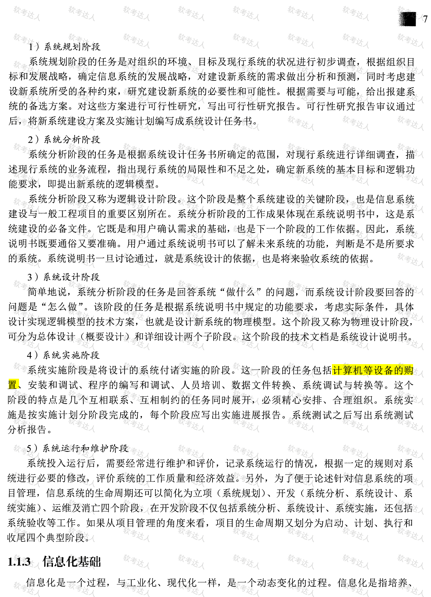
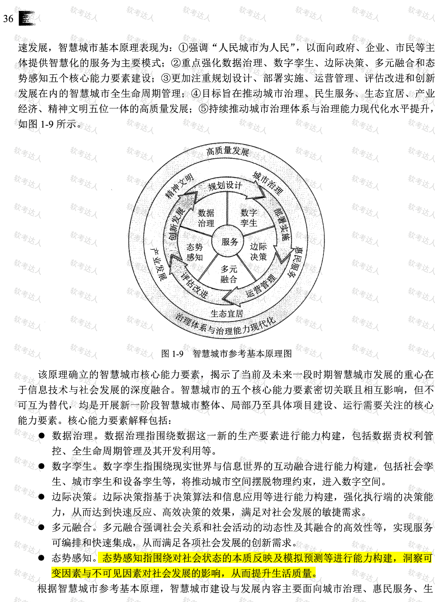

# 一、信息与信息化
## 信息
### 信息的特征
香农关于信息的定义揭示了信息的本质，同时，人们通过深入研究，发现信息还具有很多其他的特征，主要包括客观性、普遍性、无限性、动态性、相对性、依附性、变换性、传递性、层次性、系统性和转化性等。
### 信息的属性
精确性:对事物状态描述的精准程度

完整性:对事物状态描述的全面程度,完整信息应包括所有重要事实.

可靠性:指信息的来源、采集方法、传输过程是可以信任的,符合预期.

及时性:指获得信息的时刻与事件发生时刻的间隔长短.

经济性:指信息获取、传输带来的成本在可以接受的范围之内.

可验证性:指信息的主要质量属性可以被证实或者证伪的程度.

安全性:指在信息的生命周期中,信息可以被非授权访问的可能性,可能性越低,安全性越高。
## 信息化
信息化体系六要素：  
信息化政策法规和标准规范用于规范和协调信息化体系各要素之间关系，是国家信息化快速、持续、有序、健康发展的根本保障。（B选项正确）  

信息化人才是国家信息化成功之本，对其他各要素的发展速度和质量有着决定性的影响，是信息化建设的关键。  

信息技术和产业是我国进行信息化建设的基础。

信息化的基本内涵启示我们：信息化的主体是全体社会成员（A选项），包括政 府、企业、事业、团体和个人；它的时域是一个长期的过程（B选项）；它的空域是政治、经济、文化、军事和社会的一切领域；它的手段是基于现代信息技术的先进社会生产工具，它的途径是创建信息时代的社会生产力，推动社会生产关系及社会上层建筑的改革（C选项）；它的目标是使国家的综合实力、社会的文明素质和人民的生活质量全面提升（D选项）。

## 信息系统
### 信息系统的生命周期
信息系统的生命周期还可以简化为立项（系统规划）、开发（系统分析、系统设计、系统实施）、运维及消亡四个阶段。

信息系统的程序构成。数据库是经过机构化、规范化组织后的事实和信息的集合。（B错误）。系统是指由一系列相互影响、相互联系的若干组成部件，在规则的约束下构成的有机整体，这个整体具有其各个组成部件所没有的新的性质和功能，并可以和其他系统或者外部环境发生交互作用。（C错误）。信息系统的组成部件包括硬件、软件、数据库、网络、有储设备，感知设备、外设、人员以及把数据处理成信息的规程等。（D错误）。信息系统是一种以处理信息为目的的专门的系统类型。信息系统可以是手工的，也可以是计算机化的。（A正确）

信息系统的特点有：  

（1）目的性。 定义一个系统、组成一个系统或者抽象出一个系统，都有明确的目标或者目的，目标性决定了系统的功能。  
（2）可嵌套性。 系统可以包括若干子系统，系统之间也能够耦合成-一个更大的系统。换句话说，组成系统的部件也可以是系统。这个特点便于对系统进行分层、分部管理、研究或者建设。  
（3）稳定性；受规则的约束，系统的内部结构和秩序应是可以预见的；系统的状态以及演化路径有限并能被预测；系统的功能发生作用导致的后果也是可以预估的。稳定性强的系统使得系统在受到外部作用的同时，内部结构和秩序仍然能够保持。

（4）开放性。 系统的开放性是指系统的可访问性。这个特性决定了系统可以被外部环境识别，外部环境或者其他系统可以按照预定的方法，使用系统的功能或者影响系统的行为。系统的开放性体现在系统有可以清晰描述并被准确识别、理解的所谓接口层面上。  
（5）脆弱性。这个特性与系统的稳定性相对应，即系统可能存在着丧失结构、功能、秩序的特性，这个特性往往是隐藏不易被外界感知的。脆弱性差的系统，一 旦被侵入，整体性会被破坏，甚至面临崩溃，系统瓦解。

（6）健壮性：系统具有的能够抵御出现非预期状态的特性称为健壮性，也叫鲁棒性。

系统特性：
系统相似性的根本原因是世界的物质系统性，而非元素的可分性和联系（这是相关性的体现）。  
B选项错误：元素有明确边界属于相关性的特征，自组织性强调系统从无序到有序的自发过程。  
C选项错误：目的性决定系统的功能和目标，层次性描述系统与元素的相对层级关系。  
D选项正确：系统与环境发生物质和能量交换，体现了环境适应性。本题选D。
# 二、现代基础设施
## 工业互联网
工业互联网的网络体系：
- 网络互联
- 数据互通
- 标识解析
工业互联网平台体系包括边缘层、IaSS、PaSS、SaSS四个层级，相当于工业互联网的“操作系统”，它有四个作用，分别为数据汇聚、建模分析、知识复用、应用创新。
工业互联网平台体系具有四大层级，以网络为基础，平台为中枢，数据为要素，安全为保障。
物联网架构可分为三层：感知层、网络层和应用层。
工业互联网的三重属性：基础设施、应用模式和新业态。
工业互联网"将重塑企业形态、供应链和产业链"。
工业互联网能推动制造业"高端化、智能化、绿色化"发展。
工业互联网安全具有三大特点：涉及范围广、造成影响大、企业防护基础弱
工业互联网融合应用推动了一批新模式、新业态孕育兴起，初步形成了平台化设计、智能化制造、网络化协同、个性化定制、服务化延伸、数字化管理六大类典型应用模式

## 新型基础设施建设：
2018年召开的中央经济工作会议，首次提出“加快5G商用步伐，加强人工智能、工业互联网、物联网等新型基础设施建设”,简称“新基建”。“新型基础设施建设”的提法由此产生，主要包括5G 基建、特高压、城际高速铁路和城际轨道交通、新能源汽车充电桩、大数据中心、人工智能、工业互联网等七大领域。

新型基础设施是以新发展理念为引领，以技术创新为驱动，以信息网络为基础，面向高质量发展需要，提供数字转型、智能升级、融合创新等服务的基础设施体系。目前，新型基础设施主要包括如下三个方面。
(1)信息基础设施。信息基础设施主要指基于新一代信息技术演化生成的基础设施。信息基础设施包括：①以5G、物联网、工业互联网、卫星互联网为代表的通信网络基础设施；②以人工智能、云计算、区块链等为代表的新技术基础设施；③以数据中心、智能计算中心为代表的算力基础设施等。信息基础设施凸显“技术新”。
(2)融合基础设施。融合基础设施主要指深度应用互联网、大数据、人工智能等技术，支撑传统基础设施转型升级，进而形成的融合基础设施。融合基础设施包括智能交通基础设施和智慧能源基础设施等。融合基础设施重在“应用新”。
(3)创新基础设施。创新基础设施主要指支撑科学研究、技术开发、产品研制的具有公益属性的基础设施。创新基础设施包括重大科技基础设施、科教基础设施、产业技术创新基础设施等。创新基础设施强调“平台新”。

新型基础设施建设，主要包括5G基站建设、特高压、城际高速铁路和城市轨道交通、新能源汽车充电桩、大数据中心、人工智能、工业互联网七大领域。
## 智慧城市

系统感知、传递可靠、高度智能等是智慧城市重要特征。高度智能。更具深度及更具智能的信息管控能力是智慧城市的又一基础特征，对系统收集到的各类信息进行快速、准确、有效的处理，并做出智能控制管理。物联网的信息收集的功能和极强的信息处理功能，可对物体进行有效的智能管理。

数字生活主要体现在生活工具数字化、生活内容数字化和生活方式数字化等方面。